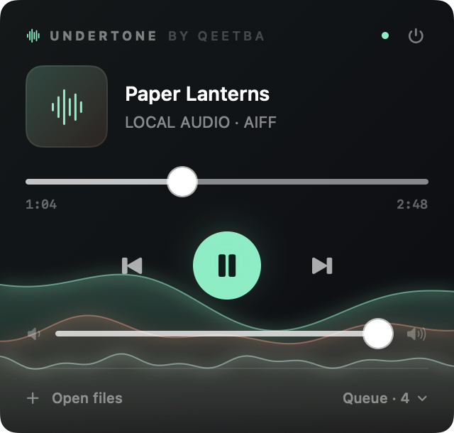
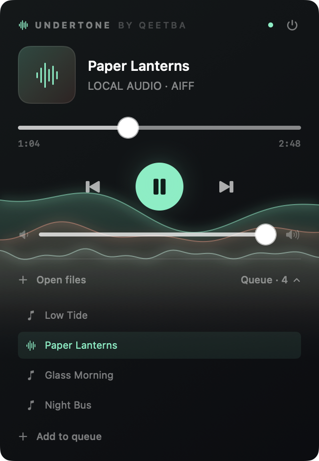

<h1 align="center">Undertone</h1>

<p align="center">
  
  &nbsp;&nbsp;
  
</p>

A menu-bar-only audio player for macOS. Lives in the status bar — no Dock icon,
no windows. Plays MP3, M4A, FLAC, AIFF and WAV through a compact dark popover with a
queue, transport controls, seek, volume and metadata/artwork display.

- **macOS 14+**, Swift 5.9, SwiftPM, AppKit status item + SwiftUI popover
- **AVAudioPlayer** playback engine (MP3 / M4A / FLAC / AIFF / WAV)
- Opening files from Finder (cold or warm launch) plays them immediately; a
  multi-file selection becomes a queue with previous/next and auto-advance
- Errors are shown visibly in the popover banner (bad file, decode failure, etc.)

## Build

```sh
./build.sh            # swift build -c release, then assemble dist/Undertone.app
open dist/Undertone.app
```

`build.sh` produces **dist/Undertone.app**, ad-hoc signed (`codesign --sign -`)
with a proper `Info.plist` (`LSUIElement`, audio document associations).
The first launch may require right-click → **Open** to satisfy Gatekeeper.

## Development

```sh
swift build                 # debug build
swift run Undertone         # run the menu-bar app from the build tree
swift test                  # unit tests (queue logic, error surfacing)
```

[CONTRIBUTING.md](CONTRIBUTING.md) covers how to send a change: what Undertone will
not trade away, how to check the popover by hand, and how pull requests are merged.

### Headless smoke test (real AVFoundation playback)

Generates a load/play/pause/seek/completion pass for each format against
fixtures at `/tmp/undertone-verification/tone.{wav,mp3,m4a,flac}`:

```sh
# From the Undertone project directory (ffmpeg needed only to generate fixtures):
bash Scripts/generate-fixtures.sh
swift run Undertone --smoke-test
UNDERTONE_SMOKE_TEST=1 swift test   # all tests, including natural queue completion
```

## Becoming the default player

The first time Undertone runs from its `.app` bundle, the popover opens by itself
with a card: **Make Undertone your default player for music files?**

- **Make default** sets Undertone as the default app for MP3, M4A, FLAC, AIFF and WAV.
- **Not now** changes nothing.

Either answer is remembered and Undertone never asks again. The card waits until
one of the two buttons is clicked; closing the popover is not an answer. It is
skipped when Undertone already opens all five formats, and deferred while macOS
is running a freshly downloaded copy from a temporary location.

To see the card again, quit Undertone (power button in the popover) and launch
it with `--offer-default-player`:

```sh
open dist/Undertone.app --args --offer-default-player
```

That shows it for that one launch, whatever answer was saved. The argument only
reaches a newly started app; if Undertone is still running, `open` just brings
the existing one forward and no card appears.

### Setting it by hand in Finder

Because it's ad-hoc signed, macOS may initially pick another player. To make
Undertone the default without the card:

1. Right-click (or Ctrl-click) an audio file in Finder → **Get Info**.
2. Under **Open with**, choose **Undertone**.
   - If it isn't listed, choose *Other…*, set *Enable:* to **All Applications**,
     and pick Undertone from `dist/` or wherever you keep it.
   - If macOS refuses because the app is "unidentified", right-click
     `Undertone.app` → **Open** once, then repeat.
3. Click **Change All…** so every file of that kind opens with Undertone.
4. Repeat per format (MP3, M4A, FLAC, AIFF, WAV), or automate with
   [duti](https://github.com/moretension/duti):
   ```sh
   duti -s com.undertone.audio .mp3 all
   duti -s com.undertone.audio .m4a all
   duti -s com.undertone.audio .flac all
   duti -s com.undertone.audio .wav all
   ```

Double-clicking an audio file then launches (or wakes) Undertone and playback
starts immediately. Multiple selected files open as a queue.

## Controls

| Action | Where |
| --- | --- |
| Show/hide player | Click the waveform icon in the menu bar |
| Open files | "Open files" button, or open from Finder; replaces the queue and plays |
| Play / pause | Center transport button |
| Previous / next | Side transport buttons (next auto-fires on track end) |
| Seek | Progress slider |
| Volume | Bottom slider |
| Show queue / pick track | Click "Queue", then a row |
| Add to the queue | "Add to queue" under the open queue; what is playing keeps playing |
| Remove from the queue | Hover a queue row, click its ✕ |
| Reorder the queue | Drag a queue row |
| Waves on / off | Click the waveform logo, top left |
| Quit | Power button, top right |

### Waves

Three waves move behind the controls in time with the music: bass drives the big
slow one, mids the middle one and treble the fine ripple in front. They are drawn
from the samples of the file at the playback position, so they follow the song
itself rather than only its loudness.

Clicking the waveform logo turns them off and on, and the choice is remembered.
Pointing at the logo shows what a click will do ("HIDE WAVES" / "SHOW WAVES").
Until it has been clicked they follow the macOS **Reduce motion** setting (off when
it is on). They only animate while the popover is open.

## Layout

```
Package.swift
Sources/UndertoneCore/       Playlist, PlayerController, MetadataLoader, ViewModel, SmokeTest,
                             DefaultPlayerOffer (first-run default-player prompt),
                             AudioBands, TrackAnalyzer, WaveDrive (what the waves listen to)
Sources/Undertone/           main.swift, AppDelegate (status item + popover), ContentView,
                             WaveBackdrop (the waves)
Tests/UndertoneTests/        QueueTests, QueueEditingTests, AudioBandsTests, DefaultPlayerOfferTests,
                             SmokeTests (env-gated real playback)
Resources/Info.plist         bundle config: LSUIElement, document types
docs/screenshots/            the pictures at the top of this file
build.sh                     release build → dist/Undertone.app
```

## Install and preview

Keep a single copy of Undertone in `~/Applications` (or `/Applications`) before
setting Finder associations, so rebuild copies do not confuse Launch Services.
Installation is manual and the build never changes default apps; only the running
app does, and only when **Make default** is clicked.

```sh
mkdir -p ~/Applications
cp -R dist/Undertone.app ~/Applications/
# Optional static UI preview (creates a PNG and exits; no menu-bar app left running):
./build.sh --render-preview /tmp/undertone-preview.png
./build.sh --render-preview /tmp/undertone-queue.png --queue-open   # with the queue drawer open
```

The screenshots at the top of this file are made the same way, from made-up
tracks. Undertone is always dark, so there is one version of each. After a
change to how the popover looks, redo them:

```sh
./build.sh --render-preview docs/screenshots/player.png
./build.sh --render-preview docs/screenshots/queue.png --queue-open
```

## Verification and limits

- Native playback smoke checks cover MP3, M4A, FLAC and WAV load/play/pause/seek/completion.
- The playback-controller integration test covers natural queue advance and volume preservation.
- AIFF was additionally checked with a real 48 kHz stereo, 168.5-second file.
- Finder cold/warm file-opening is wired through the standard application delegate;
  the actual Finder interaction and interactive popover controls still need a manual check.
- Encrypted/DRM audio and Ogg/Vorbis are not supported. Decoder support for other
  native formats depends on macOS. There are no streaming services or library indexing.
- The bundle is signed ad hoc for local use, not notarized for distribution.

## License

Licensed under Apache License 2.0; see [LICENSE](LICENSE).

---

<p align="center">Made in Seattle with ❤️ by Qeetba Records</p>
